<!-- ============================================================ -->
<!--   hey you, reading the source 👀  respect. welcome to the matrix. -->
<!-- ============================================================ -->

<div align="center">


<a href="https://github.com/shreyas23dev">
  
</a>

<br/>

<a href="https://www.linkedin.com/in/shreyas-a-027823280/"></a>


</div>


<!-- ======================= ABOUT ======================= -->
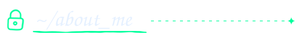

<div align="center">
  
</div>


<!-- ======================= PROJECTS ======================= -->
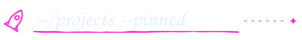

<div align="center">

<a href="https://github.com/shreyas23dev/Attack-Phase-Aware-Dynamic-Vulnerability-Prioritization-Framework">
  
</a>

<table>
  <tr>
    <td width="50%" align="center">
      <a href="https://github.com/shreyas23dev/DataPrepX-A-tool-for-Enhancing-quality-through-pre-processing-technique-in-Data-Analytics">
        
      </a>
    </td>
    <td width="50%" align="center">
      <a href="https://github.com/shreyas23dev/HardenMe-">
        
      </a>
    </td>
  </tr>
  <tr>
    <td width="50%" align="center">
      <a href="https://github.com/shreyas23dev/Optimizing-RSA-for-IoT-C-Implementation-was-a-part-of-side-channel-attack-counter-measure">
        
      </a>
    </td>
    <td width="50%" align="center">
      <a href="https://github.com/shreyas23dev/Adaptive-Vulnerability-Prioritization-with-MITRE-ATT-CK-Integration">
        
      </a>
    </td>
  </tr>
</table>

<sub>👆 click any card to jack into the repo</sub>

</div>


<!-- ======================= ARSENAL ======================= -->
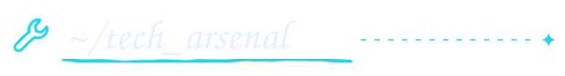

<div align="center">

<table>
  <tr>
    <td align="center"><b><code>&lt;languages/&gt;</code></b></td>
    <td></td>
  </tr>
  <tr>
    <td align="center"><b><code>&lt;sec_ops/&gt;</code></b></td>
    <td></td>
  </tr>
  <tr>
    <td align="center"><b><code>&lt;ml_data/&gt;</code></b></td>
    <td></td>
  </tr>
  <tr>
    <td align="center"><b><code>&lt;tooling/&gt;</code></b></td>
    <td></td>
  </tr>
</table>


</div>


<!-- ======================= STATS ======================= -->
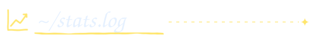

<div align="center">

<!-- these two cards are generated by .github/workflows/stats.yml (no rate limits, no broken images) -->

<!-- snake is generated by .github/workflows/snake.yml -->
<picture>
  <source media="(prefers-color-scheme: dark)" srcset="https://raw.githubusercontent.com/shreyas23dev/shreyas23dev/output/snake-dark.svg"/>
  <source media="(prefers-color-scheme: light)" srcset="https://raw.githubusercontent.com/shreyas23dev/shreyas23dev/output/snake.svg"/>
  
</picture>

<sub>🐍 a snake is eating my contribution graph. i'm told this is normal.</sub>

</div>


<!-- ======================= CONTACT ======================= -->
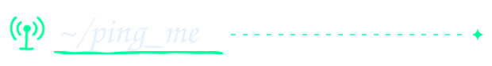

<div align="center">

```bash
$ ping shreyas --collab --research --ctf --chai
PING shreyas (127.0.0.1): always up for cool security + ML ideas
64 bytes: icmp_seq=1 ttl=64 reply="let's build something secure 🔐"
```

<a href="https://www.linkedin.com/in/shreyas-a-027823280/"></a>

<a href="https://github.com/shreyas23dev?tab=repositories"></a>

<br/><br/>

<details>
<summary><b>🕹️ psst… don't click this</b></summary>
<br/>

```text
     _______________________________
    |  WAKE UP, VISITOR...          |
    |  THE MATRIX HAS YOU.          |
    |  FOLLOW THE WHITE RABBIT.     |
    |_______________________________|
              \   (\_/)
               \  (o.o)  < 0x1337
                  (> <)

   [ red pill ]  ->  star a repo ⭐
   [ blue pill ] ->  you'll still star a repo ⭐
```

</details>

</div>

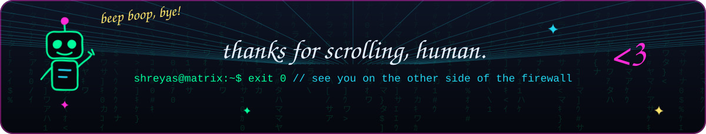
